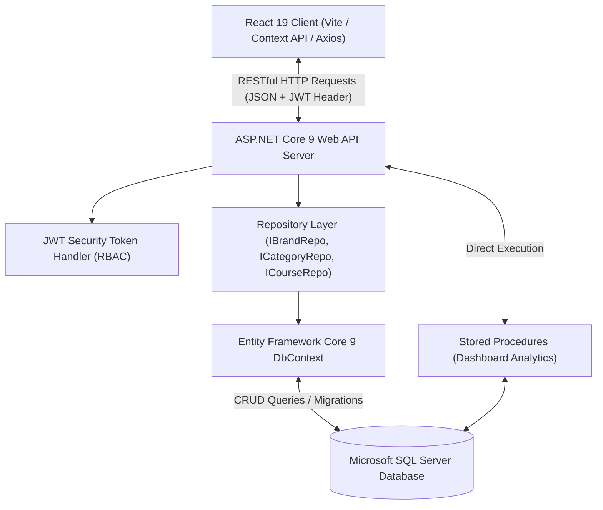

# ProductCatalogSPA — Full-Stack Enterprise Platform (.NET 9 & React 19)


ProductCatalogSPA is an enterprise full-stack Single Page Application featuring an **ASP.NET Core Web API (.NET 9)** backend and a modern **React 19 (Vite)** frontend. The application implements clean architectural separation with Repository Pattern, DTO contracts, JWT Bearer authentication, and SQL Server Stored Procedures for high-performance dashboard analytics.

---

## 🌟 Key Features

- **Decoupled Architecture:** Clean client-server separation between ASP.NET Core 9 Web API and React 19 Vite client.
- **JWT Bearer Authentication:** Secure user registration, authentication, role claims, and persistent session state handled via React Context API (`AuthContext`).
- **Master-Detail Data Management:** Full CRUD operations for hierarchical entities including Categories, Brands, Courses, and Course Modules.
- **High-Performance Analytics:** Dashboard metrics and summary statistics calculated using optimized SQL Server Stored Procedures (`AddDashboardSP`).
- **Entity Framework Core 9:** Code-First relational schema modeling with automated database migrations and seeding.
- **Modern Responsive UI:** Polished sidebar navigation, modal dialogs, status badges, and dual view modes built with React 19 and modern CSS.

---

## 🏗️ System Architecture



---

## 📂 Repository Structure

```
ProductCatalogSPA/
├── ProductCatalogSPA.API/          # ASP.NET Core 9 Web API Backend
│   ├── Controllers/               # Auth, Brands, Categories, Courses, Dashboard
│   ├── Data/                      # AppDbContext with EF Core configurations
│   ├── DTOs/                      # Data Transfer Objects (AuthDtos, etc.)
│   ├── Migrations/                # EF Core database migrations & SP scripts
│   ├── Models/                    # ApplicationUser, Brand, Category, Course
│   ├── Repositories/              # Interface-driven repository implementations
│   ├── Program.cs                 # Dependency injection, CORS, & JWT middleware
│   └── appsettings.json           # Connection string & JWT signing keys
└── ProductCatalogSPA.UI/           # React 19 Single Page Application
    ├── src/
    │   ├── components/            # Reusable UI widgets (Sidebar, etc.)
    │   ├── context/               # AuthContext state provider
    │   ├── pages/                 # Dashboard, Brands, Categories, Courses, Login
    │   ├── services/              # Axios/Fetch API service client (api.js)
    │   ├── App.jsx                # Route definitions & protected routes
    │   └── main.jsx               # React DOM root entry
    ├── package.json               # NPM packages & build scripts
    └── vite.config.js             # Vite development server configuration
```

---

## ⚙️ Local Setup & Installation

### Prerequisites
- [.NET 9.0 SDK](https://dotnet.microsoft.com/download/dotnet/9.0)
- [Node.js](https://nodejs.org/) (v18.x or v20.x+)
- [Microsoft SQL Server](https://www.microsoft.com/sql-server) (LocalDB, Express, or Developer edition)

---

### Step 1: Backend Setup (.NET 9 Web API)

1. Open a terminal and navigate to the API directory:
   ```bash
   cd ProductCatalogSPA.API
   ```

2. Restore NuGet dependencies:
   ```bash
   dotnet restore
   ```

3. Update the connection string in `appsettings.json` if required (defaults to `(localdb)\mssqllocaldb`):
   ```json
   "ConnectionStrings": {
     "DefaultConnection": "Server=(localdb)\\mssqllocaldb;Database=ProductCatalogSPADb;Trusted_Connection=True;MultipleActiveResultSets=true"
   }
   ```

4. Apply database migrations:
   ```bash
   dotnet ef database update
   ```

5. Run the API:
   ```bash
   dotnet run
   ```
   *The API will start at `https://localhost:5001` or `http://localhost:5000` with Swagger UI documentation enabled.*

---

### Step 2: Frontend Setup (React 19 + Vite)

1. Open a new terminal and navigate to the UI directory:
   ```bash
   cd ProductCatalogSPA.UI
   ```

2. Install dependencies:
   ```bash
   npm install
   ```

3. Start the development server:
   ```bash
   npm run dev
   ```

4. Open your browser at: **`http://localhost:5173`**

---

## 👤 Author
**A.H.M. Zafir Hasan**  
Full-Stack Developer • .NET, Mobile & Web Systems  
- **GitHub:** [@Zafff-e](https://github.com/Zafff-e)  
- **Portfolio:** [zafff-e.github.io](https://zafff-e.github.io)  
- **LinkedIn:** [zafir-hasan-developer](https://linkedin.com/in/zafir-hasan-developer)
