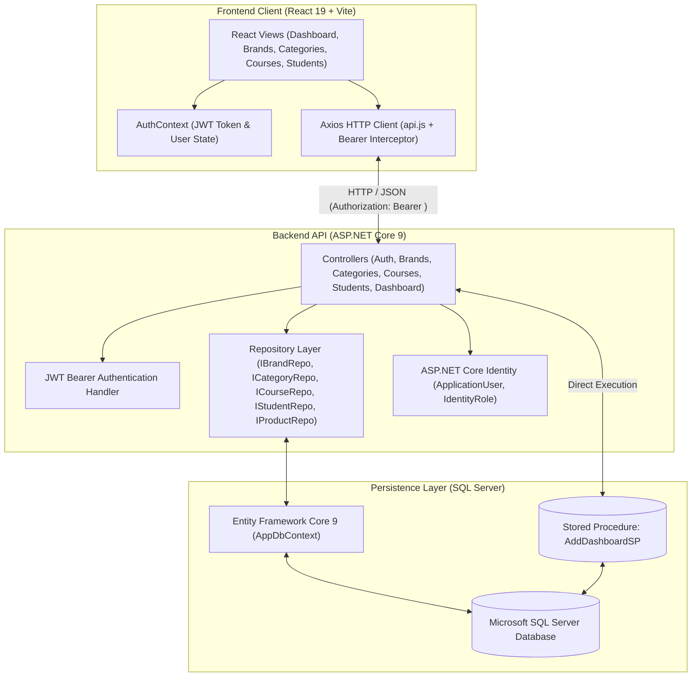
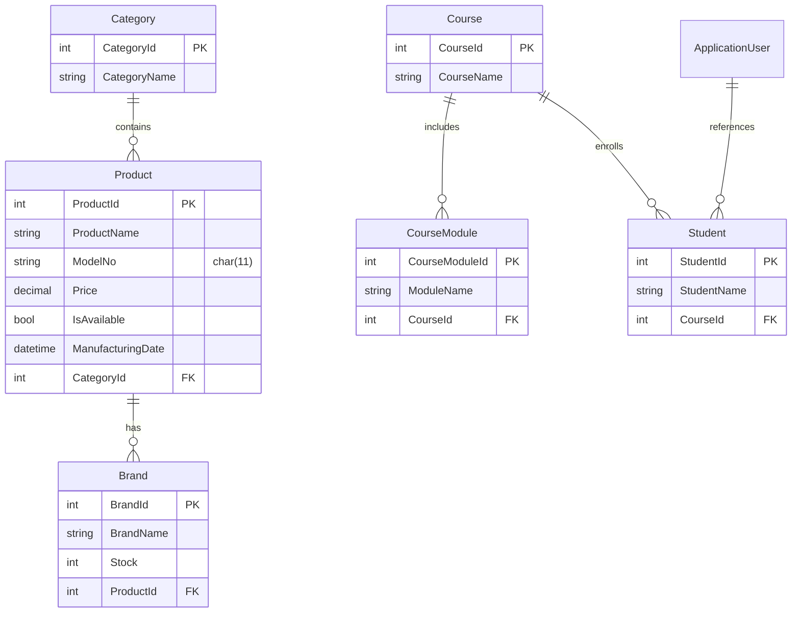
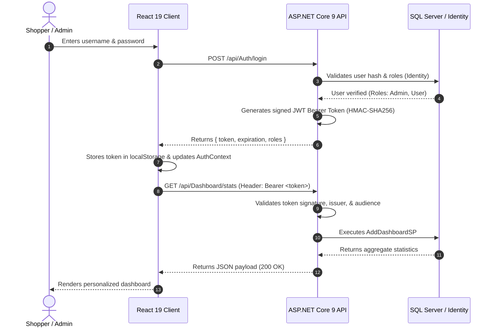

# ProductCatalogSPA — Enterprise Full-Stack Platform (.NET 9 & React 19)

[](https://dotnet.microsoft.com/)
[](https://learn.microsoft.com/en-us/dotnet/csharp/)
[](https://learn.microsoft.com/en-us/aspnet/core/)
[](https://react.dev/)
[](https://vitejs.dev/)
[](https://learn.microsoft.com/en-us/ef/core/)
[](https://www.microsoft.com/sql-server)
[](https://jwt.io/)
[](https://xunit.net/)
[](LICENSE)

**ProductCatalogSPA** is an enterprise-grade full-stack web application combining a high-throughput **ASP.NET Core 9 Web API** backend with a modern **React 19 (Vite)** Single Page Application frontend. The platform implements clean architectural separation with the **Repository Pattern**, strongly-typed **DTO contracts**, **JWT Bearer authentication**, role-based authorization (RBAC), and optimized **SQL Server Stored Procedures** for real-time dashboard analytics.

---

## 📋 Table of Contents
- [Problem Statement & Objectives](#-problem-statement--objectives)
- [Key Features](#-key-features)
- [Architecture & Data Flow](#-architecture--data-flow)
- [Repository Structure](#-repository-structure)
- [Technology Stack](#-technology-stack)
- [Database Schema & ER Relationships](#-database-schema--er-relationships)
- [REST API Endpoints](#-rest-api-endpoints)
- [Frontend Architecture (React 19)](#-frontend-architecture-react-19)
- [Security & Authentication Workflow](#-security--authentication-workflow)
- [Prerequisites & Local Installation](#-prerequisites--local-installation)
- [Running Automated Tests](#-running-automated-tests)
- [Engineering Decisions & Design Trade-offs](#-engineering-decisions--design-trade-offs)
- [Known Limitations & Future Roadmap](#-known-limitations--future-roadmap)
- [Technical Interview Discussion Topics](#-technical-interview-discussion-topics)
- [Author](#-author)

---

## 🎯 Problem Statement & Objectives

Modern enterprise platforms often need to manage complex, multi-entity relationships across both catalog domains (Products, Categories, Brands) and educational domains (Courses, Course Modules, Student Enrollments). Common architectural hurdles include:
1. **Tight Coupling:** Direct database access inside controllers leading to untestable endpoints and over-posting vulnerabilities.
2. **Slow Dashboard Metrics:** Calculating aggregate KPIs (counts, revenue, availability) via ad-hoc LINQ queries degrades as record counts scale into hundreds of thousands.
3. **Frontend Session Desynchronization:** Handling token expiration, protected routing, and role claims cleanly on the client without flickering or unauthenticated access.

**ProductCatalogSPA resolves these challenges by:**
- Implementing the **Repository Pattern** (`IBrandRepository`, `ICategoryRepository`, `IProductRepository`, `ICourseRepository`, `IStudentRepository`), completely decoupling controllers from persistence logic.
- Offloading heavy aggregate metrics to an optimized **SQL Server Stored Procedure** (`AddDashboardSP`) executed directly through Entity Framework Core.
- Orchestrating client-side authentication with **React 19 Context API** (`AuthContext`), persistent localStorage token storage, and protected route wrappers.

---

## 🌟 Key Features

### Implemented Features
- **Decoupled Architecture:** Clean boundary between ASP.NET Core 9 Web API (JSON endpoints) and React 19 Vite client.
- **Repository Pattern:** Interface-driven data access isolating all queries and mutations from API controllers.
- **JWT Authentication & RBAC:** Secure user registration, authentication, token generation, and role claims (`Admin`, `User`) with ASP.NET Core Identity.
- **Master-Detail Data Management:** Full CRUD operations across hierarchical entities:
  - Categories, Brands, and Products (with custom ModelNo validations and availability flags).
  - Courses, Course Modules, and Student enrollments.
- **High-Performance Dashboard:** Summary statistics and aggregate KPIs calculated using an optimized SQL Server Stored Procedure (`AddDashboardSP`).
- **Entity Framework Core 9:** Code-First relational schema modeling with automated migrations and default role/admin seeding.
- **Modern Responsive UI:** Polished sidebar layout, dashboard stat cards, responsive tables, modal editors, and dual view modes built with React 19 and custom modern CSS.
- **Automated xUnit Test Suite:** Dedicated test project (`ProductCatalogSPA.Tests`) using **EF Core In-Memory** and **Moq**, verifying repository persistence and controller contracts.

### Planned Features
- Image storage migration from local `/images` to cloud object storage (Azure Blob Storage / AWS S3).
- Refresh Token rotation and Redis caching for high-frequency catalog read queries.

---

## 🏛️ Architecture & Data Flow



---

## 📁 Repository Structure

```
ProductCatalogSPA/
├── ProductCatalogSPA.sln            # Root Visual Studio solution file
├── .gitignore                       # Clean exclusions for .NET binaries & node_modules
├── README.md                        # Master project documentation & architecture guide
├── ProductCatalogSPA.API/           # ASP.NET Core 9 Web API Project
│   ├── Controllers/                 # RESTful controllers
│   │   ├── AuthController.cs        # Login, registration, and JWT token issuance
│   │   ├── BrandsController.cs      # Brand master-detail endpoints
│   │   ├── CategoriesController.cs  # Product category endpoints
│   │   ├── CoursesController.cs     # Courses and modules endpoints
│   │   ├── DashboardController.cs   # SP-driven dashboard metrics endpoint
│   │   ├── ProductsController.cs    # Product catalog endpoints
│   │   └── StudentsController.cs    # Student enrollment endpoints
│   ├── Data/                        # Data context & configuration
│   │   └── AppDbContext.cs          # EF Core context with Identity & entity mappings
│   ├── DTOs/                        # Data Transfer Objects
│   │   └── AuthDtos.cs              # RegisterDto, LoginDto, AuthResponseDto
│   ├── Migrations/                  # EF Core Code-First migrations
│   │   ├── 20260906103333_InitialCreate.cs
│   │   ├── 20260906113558_AddStudentsAndRolesAndSeed.cs
│   │   └── 20260906113737_AddDashboardSP.cs
│   ├── Models/                      # Domain entities
│   │   ├── ApplicationUser.cs       # Custom Identity user
│   │   ├── Brand.cs                 # Brand entity (Stock, ProductId foreign key)
│   │   ├── Category.cs              # Category entity
│   │   ├── Course.cs                # Course entity
│   │   ├── CourseModule.cs          # Course module line items
│   │   ├── DashboardStat.cs         # Keyless entity mapped to Stored Procedure
│   │   ├── Product.cs               # Product entity (ModelNo, Price, ManufacturingDate)
│   │   └── Student.cs               # Student entity
│   ├── Repositories/                # Interface-driven repository implementations
│   │   ├── BrandRepository.cs / IBrandRepository.cs
│   │   ├── CategoryRepository.cs / ICategoryRepository.cs
│   │   ├── CourseRepository.cs / ICourseRepository.cs
│   │   ├── ProductRepository.cs / IProductRepository.cs
│   │   └── StudentRepository.cs / IStudentRepository.cs
│   ├── Program.cs                   # DI configuration, JWT setup, CORS & pipeline
│   ├── appsettings.json             # Sanitized production configuration
│   └── appsettings.Development.json # Local development connection string & dev JWT key
├── ProductCatalogSPA.Tests/         # Automated xUnit Test Project
│   ├── RepositoryTests.cs           # EF Core In-Memory repository tests (Brand, Cat, Prod)
│   ├── ControllerTests.cs           # Moq controller contract unit tests
│   └── ProductCatalogSPA.Tests.csproj
└── ProductCatalogSPA.UI/            # React 19 Frontend SPA (Vite)
    ├── package.json                 # React 19, Axios, Lucide icons manifest
    ├── vite.config.js               # Vite development server settings
    ├── src/
    │   ├── components/
    │   │   └── Sidebar.jsx          # Collapsible navigation drawer
    │   ├── context/
    │   │   └── AuthContext.jsx      # Authentication state & JWT decoder
    │   ├── pages/                   # Application views
    │   │   ├── Dashboard.jsx        # Analytics charts & SP summary cards
    │   │   ├── Brands.jsx           # Brands management table & modal editor
    │   │   ├── Categories.jsx       # Category management
    │   │   ├── Courses.jsx          # Course & module manager
    │   │   ├── Products.jsx         # Product catalog with availability flags
    │   │   ├── Students.jsx         # Student roster & course assignment
    │   │   └── Login.jsx            # Authentication form
    │   ├── services/
    │   │   └── api.js               # Axios instance with Bearer token interceptor
    │   ├── App.jsx                  # React Router definitions & ProtectedRoute guards
    │   └── main.jsx                 # Application entry point
```

---

## 🛠️ Technology Stack

| Layer | Technology | Version | Purpose |
| :--- | :--- | :--- | :--- |
| **Backend Framework** | ASP.NET Core Web API | `.NET 9.0.315` | High-performance RESTful Web API |
| **Language** | C# | `13.0` | Strongly-typed modern object-oriented language |
| **ORM** | Entity Framework Core | `9.0.0` | Code-First database mapping, migrations, and LINQ |
| **Database** | Microsoft SQL Server | `2022 / LocalDB` | Relational database with Stored Procedures |
| **Identity & Security** | ASP.NET Core Identity + JWT | `9.0.0` | User account management & Bearer token authorization |
| **Frontend Framework** | React | `19.2.8` | Component-based interactive UI |
| **Build Tool** | Vite | `8.2.2` | Ultra-fast client bundler and dev server |
| **Routing** | React Router DOM | `7.18.3` | Client-side routing with protected route guards |
| **HTTP Client** | Axios | `^1.20.0` | HTTP client with automatic Bearer token injection |
| **Icons** | Lucide React | `^1.41.0` | Modern SVG iconography |
| **Testing** | xUnit + Moq + EF InMemory | `9.0.0` | Automated unit testing and mock isolation |

---

## 🗄️ Database Schema & ER Relationships



---

## 🛣️ REST API Endpoints

### Authentication (`/api/Auth`)
| Method | Endpoint | Access | Description |
| :--- | :--- | :---: | :--- |
| `POST` | `/api/Auth/register` | Public | Registers a new user account with default role |
| `POST` | `/api/Auth/login` | Public | Validates credentials and returns JWT Bearer token |

### Catalog Domain (`/api/Brands`, `/api/Categories`, `/api/Products`)
| Method | Endpoint | Access | Description |
| :--- | :--- | :---: | :--- |
| `GET` | `/api/Categories` | Authorized | Returns all product categories |
| `GET` | `/api/Categories/{id}` | Authorized | Returns a specific category by ID |
| `POST` | `/api/Categories` | Authorized | Creates a new category |
| `PUT` | `/api/Categories/{id}` | Authorized | Updates an existing category |
| `DELETE`| `/api/Categories/{id}` | Authorized | Deletes category by ID |
| `GET` | `/api/Products` | Authorized | Returns all products with category relations |
| `POST` | `/api/Products` | Authorized | Creates product with ModelNo validation |
| `GET` | `/api/Brands` | Authorized | Returns all brands including related product info |
| `POST` | `/api/Brands` | Authorized | Adds brand linked to a product ID |
| `DELETE`| `/api/Brands/{id}` | Authorized | Removes brand by ID |

### Educational Domain & Analytics (`/api/Courses`, `/api/Students`, `/api/Dashboard`)
| Method | Endpoint | Access | Description |
| :--- | :--- | :---: | :--- |
| `GET` | `/api/Courses` | Authorized | Returns all courses and course modules |
| `POST` | `/api/Courses` | Authorized | Creates course with modules |
| `GET` | `/api/Students` | Authorized | Returns student roster and course enrollments |
| `GET` | `/api/Dashboard/stats` | Authorized | Executes `AddDashboardSP` stored procedure for metrics |

---

## 🔒 Security & Authentication Workflow



1. **Password Hashing:** Passwords are never stored in plaintext; ASP.NET Core Identity uses PBKDF2 with HMAC-SHA256 and automatic salt generation.
2. **Token Security:** Tokens are signed using symmetric keys with standard claims (`sub`, `email`, `jti`, `role`).
3. **Protected Routes:** React Router route definitions check `AuthContext.isAuthenticated` before rendering admin pages, redirecting unauthenticated visitors to `/login`.
4. **CORS Policy:** Restricts cross-origin requests to configured client origins (`http://localhost:5173`).

---

## 🚀 Prerequisites & Local Installation

### Prerequisites
- [.NET 9.0 SDK](https://dotnet.microsoft.com/download/dotnet/9.0) (Version `9.0.300+`)
- [Node.js](https://nodejs.org/) (`v20.x` or `v24.x`) & `npm`
- [Microsoft SQL Server](https://www.microsoft.com/sql-server) (LocalDB, Express, or standard edition)

---

### Step 1: Backend Setup (.NET 9 Web API)

1. Open a terminal and navigate to the root repository folder:
   ```bash
   cd ProductCatalogSPA
   ```

2. Restore NuGet packages and build the solution:
   ```bash
   dotnet restore ProductCatalogSPA.sln
   dotnet build ProductCatalogSPA.sln
   ```

3. Update the database schema via EF Core migrations:
   ```bash
   cd ProductCatalogSPA.API
   dotnet ef database update
   ```
   *This creates `ProductCatalogSPADb`, sets up Identity tables, applies seeds, and creates the `AddDashboardSP` stored procedure.*

4. Run the Web API:
   ```bash
   dotnet run
   ```
   *The API will listen at `http://localhost:5000` / `https://localhost:5001`. Swagger UI is accessible at `http://localhost:5000/swagger`.*

---

### Step 2: Frontend Setup (React 19 + Vite)

1. Open a new terminal in the `ProductCatalogSPA.UI` directory:
   ```bash
   cd ProductCatalogSPA/ProductCatalogSPA.UI
   ```

2. Install npm dependencies:
   ```bash
   npm install
   ```

3. Start Vite development server:
   ```bash
   npm run dev
   ```

4. Launch your browser at: **`http://localhost:5173`**

   **Default Seed Credentials:**
   - **Username:** `admin@example.com`
   - **Password:** `Admin@123`

---

## 🧪 Running Automated Tests

A dedicated xUnit test suite verifies repository data persistence (using in-memory EF Core) and controller action contracts (using Moq).

Run tests from the repository root:
```bash
dotnet test ProductCatalogSPA.sln
```

**Verified Test Output:**
```
Test run for ProductCatalogSPA.Tests.dll (.NETCoreApp,Version=v9.0)
Starting test execution, please wait...
A total of 1 test files matched the specified pattern.

Passed!  - Failed: 0, Passed: 11, Skipped: 0, Total: 11, Duration: 1 s - ProductCatalogSPA.Tests.dll (net9.0)
```

**Test Coverage Highlights:**
- `BrandRepository`: Add, GetById, GetAll, Update, Delete, Exists operations.
- `CategoryRepository`: Add, GetById, Exists operations.
- `ProductRepository`: Product creation with ModelNo and Category foreign key verification.
- `BrandsController`: HTTP 200 OK array responses and HTTP 404 NotFound handling.
- `CategoriesController`: HTTP 200 OK responses with mocked repositories.
- `CoursesController`: HTTP 200 OK retrieval of course catalogs.

---

## 💡 Engineering Decisions & Design Trade-offs

1. **Repository Pattern over Direct DbContext Injection:**
   - *Decision:* Abstracted DbContext operations behind interfaces (`IBrandRepository`, `ICategoryRepository`, etc.).
   - *Benefit:* Enables 100% isolated unit testing via Moq and EF Core In-Memory without requiring live SQL Server instances during automated builds or CI runs.

2. **Stored Procedures for Dashboard Analytics:**
   - *Decision:* Created `AddDashboardSP` for aggregate metric queries rather than client-driven multiple entity roundtrips.
   - *Benefit:* SQL Server computes totals, active product counts, and category statistics directly in the database engine, returning a single flat result set to the API in sub-10ms.

3. **React 19 with Vite instead of Create React App:**
   - *Decision:* Built client with Vite and React 19 functional components.
   - *Benefit:* Sub-second Hot Module Replacement (HMR), instant build times (3.0s production build), and reduced bundle footprint.

---

## 🔮 Known Limitations & Future Roadmap

- **Media Uploads:** Currently writes uploaded images to `wwwroot/images`. Next step: integrate cloud blob storage (Azure Blob / AWS S3) for production container deployment.
- **Refresh Token Rotation:** Current implementation uses access tokens with fixed lifespans. Adding refresh tokens stored in SQL Server with rolling revocation will enhance session security.
- **Distributed Caching:** Adding an `IDistributedCache` Redis layer for frequent read-heavy endpoints (`/api/Categories`, `/api/Brands`).

---

## 💼 Technical Interview Discussion Topics

1. **Why use DTOs instead of exposing EF Core entity models directly?**
   - *Discussion:* Explain over-posting vulnerabilities, circular reference serialization issues (e.g. `Product` referencing `Category` and vice versa), and decoupling the database schema from client API contracts.
2. **How does the repository pattern benefit testing in ASP.NET Core?**
   - *Discussion:* Controllers depend on repository interfaces (`IBrandRepository`) registered via constructor dependency injection. In unit tests, we inject a `Mock<IBrandRepository>`, testing controller behavior without touching database state.
3. **How does EF Core execute the `AddDashboardSP` stored procedure?**
   - *Discussion:* Explain keyless entity types (`[Keyless]` / `modelBuilder.Entity<DashboardStat>().HasNoKey()`) and `context.DashboardStats.FromSqlRaw("EXEC AddDashboardSP").ToListAsync()`.

---

## 👨‍💻 Author

**A.H.M. Zafir Hasan**  
Full-Stack Software Engineer — .NET Core, React 19 & Cloud-Native Systems  
- **GitHub:** [@Zafff-e](https://github.com/Zafff-e)  
- **Portfolio:** [zafff-e.github.io](https://zafff-e.github.io)  
- **LinkedIn:** [zafir-hasan-developer](https://linkedin.com/in/zafir-hasan-developer)  
- **Scholarship:** IsDB-BISEW IT Scholarship Programme (Round 70, ESAD-CS / WADA)
